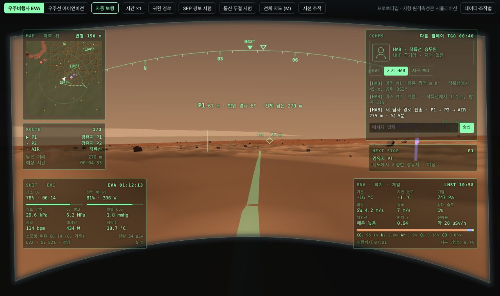
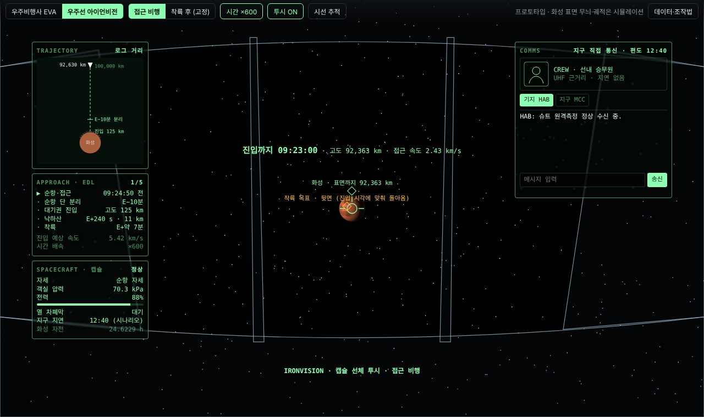
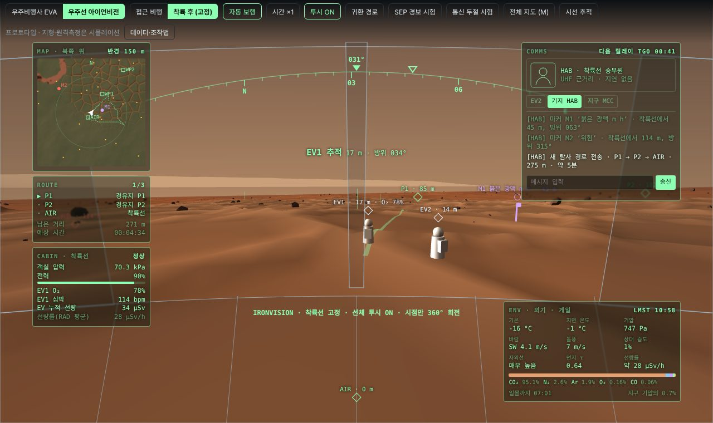
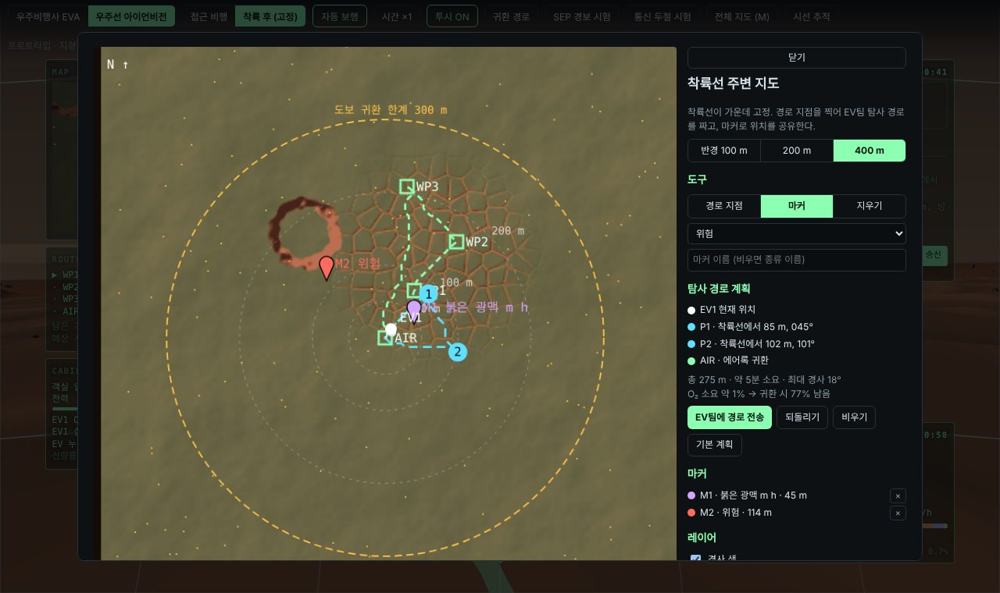
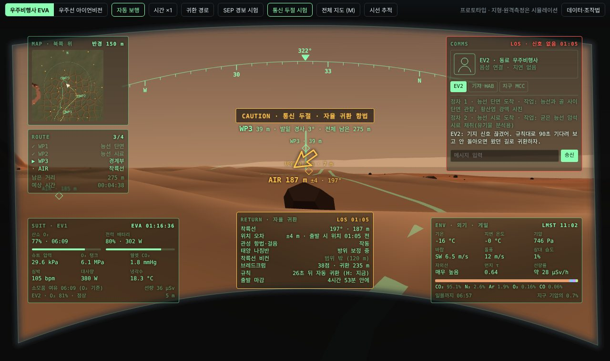

# Martian Map · Marswalk HUD

NASA Space Apps Challenge 2026 「Interplanetary Survival Guide: Martian Map」 참가 프로젝트 (경희대학교, 5인 팀).

화성 게일 크레이터(Mount Sharp 박스워크 지대)에서 우주비행사가 **어디로 걸어가 무엇을 조사할지** 계획하고, 그 계획을 **헬멧 HUD**와 **착륙선 아이언비전 화면**으로 보여주는 웹 앱이다. 지금 단계는 NASA 챌린지 데이터가 공개되기 전의 **UI/UX 프로토타입 + 개발 계획서**다.

> 지형·바위·원격측정·기상 값은 브라우저에서 만든 시뮬레이션이다. 대기 성분(Curiosity SAM)처럼 근거가 있는 값은 화면 안 `데이터·조작법`과 계획서에 출처를 적었다.



## 바로 실행

설치가 필요 없다. `prototype/marswalk-hud.html`을 Chrome에서 열면 된다(인터넷 연결 필요: three.js, 글꼴, 시선 추적 모델을 CDN에서 받는다).

```bash
# 또는 로컬 서버로
cd prototype && python -m http.server 8000
# → http://localhost:8000/marswalk-hud.html
```

## 화면 구성

| 모드 | 내용 |
|---|---|
| 우주비행사 EVA | 헬멧 바이저 HUD. 왼쪽 위 미니맵·경로, 왼쪽 아래 **SUIT**(산소·전력·압력·CO₂·심박·대사량·냉각수·소모품 여유), 오른쪽 위 통신, 오른쪽 아래 **ENV 외기**(기온·지면 온도·기압·바람·습도·자외선·먼지 τ·대기 성분), 위쪽 방위 테이프, 경고는 시선 가까이 |
| 우주선 아이언비전 · 접근 비행 | 화성으로 다가가는 캡슐에서 선체를 투시해 화성과 착륙 목표를 본다. 진입까지 남은 시간, 순항 단 분리(E−10분), EDL 단계 |
| 우주선 아이언비전 · 착륙 후 | 착륙선은 고정. 시점만 360° 돌려 EV 대원·정차 지점·위험 지형을 추적 |

| 접근 비행 | 착륙 후 |
|---|---|
|  |  |

## 주요 기능

- **안전 경로**: 5 m 격자 A* 탐색. 경사가 클수록 비용 증가, 25° 이상·큰 바위 셀은 제외.
- **주변 지도·탐사 계획** (`M`): 반경 100/200/400 m, 거리 링과 도보 귀환 한계(300 m). 경유지를 찍으면 총 거리·소요 시간·최대 경사·O₂ 소요를 바로 계산하고 EV팀에 전송. 마커 4종(과학 관심·시료·위험·메모)은 지도·미니맵·3D에 모두 표시.
- **통신 두절 시 자율 귀환** (`통신 두절 시험`): 관성 항법 + 브레드크럼, 지형 대조·태양 나침반·착륙선 비컨으로 오차 보정. 귀환 화살표, 위치 오차 원, 산소 기준 출발 마감, 90초 무응답 시 왔던 길 역추적.
- **시선 추적** (`시선 추적`): 노트북 카메라 + WebGazer.js. 9점 보정, 응시 0.9초로 버튼 누르기, 바라보는 패널만 또렷하게, 표지 세부 정보 펼치기. 고개 방향(얼굴 메시)으로 시선 보정 + 배경 회전. 형광 빨간 점으로 인식된 시선 표시. 카메라가 없으면 마우스 체험 모드.
- **우주 기상**: SEP(태양 고에너지 입자) 경보 시험 → 즉시 귀환 경로.

| 지도 계획 | 통신 두절 |
|---|---|
|  |  |

## 조작

| 키 | 동작 |
|---|---|
| 드래그 | 둘러보기 |
| `W A S D` / 방향키 | 걷기(자동 보행 해제) |
| `M` | 지도 |
| `H` | 귀환 경로 (통신 두절 중에는 왔던 길 역추적) |
| `Tab` | EVA ↔ 아이언비전 |
| `C` | 시선 추적 중 고개 정면 다시 맞추기 |

## 폴더

```
prototype/marswalk-hud.html   단일 파일 프로토타입 (three.js r128)
docs/development-plan.md      개발 계획서 (데이터 계층·분석 엔진·HUD 설계·일정·역할·리스크)
docs/screenshots/             README 이미지
```

## 다음 단계 (해커톤 11/14–15)

계획서 12장 체크리스트 참고. 요약하면 챌린지 데이터가 공개되는 대로 어댑터를 붙여 시뮬레이션 지형을 HiRISE DTM·CRISM 광물·THEMIS 열관성·REMS 기상 실측으로 교체하고, 경로·마커를 백엔드(`POST /plan`, `POST /markers`)에 저장해 EV 화면과 기지 화면이 공유하게 한다.

## 라이선스 메모

- 시선 추적에 쓰는 [WebGazer.js](https://webgazer.cs.brown.edu/)는 **GPL-3.0**이다. 저장소에 포함하지 않고 실행 시 CDN에서 불러온다. 다른 라이선스로 배포하려면 계획서 6.6의 대안(MediaPipe Face Landmarker, Apache-2.0)을 검토한다.
- three.js는 MIT.
- 이 저장소 자체의 라이선스는 팀에서 정한다.
