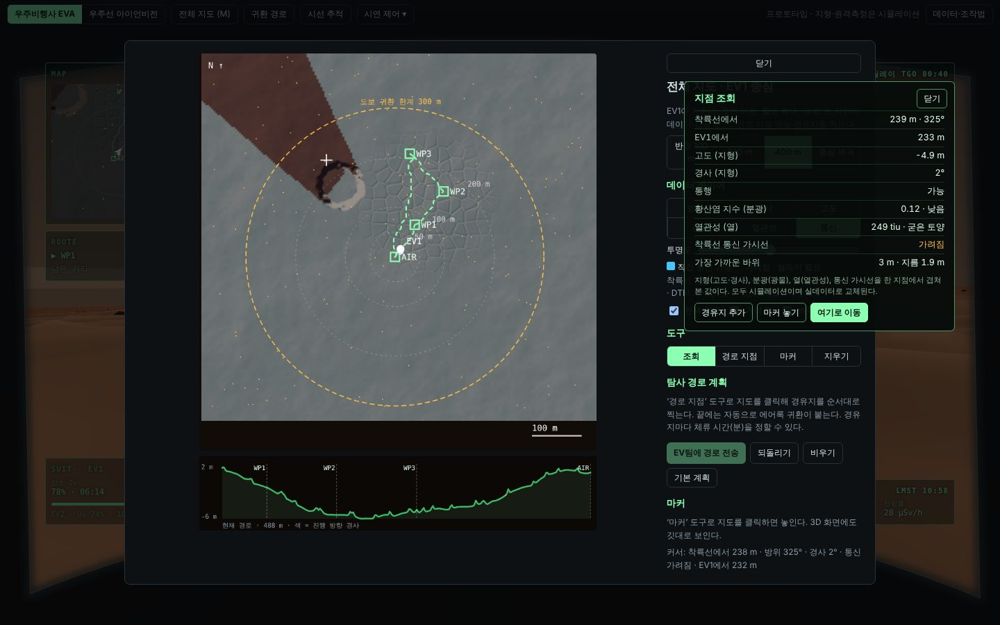
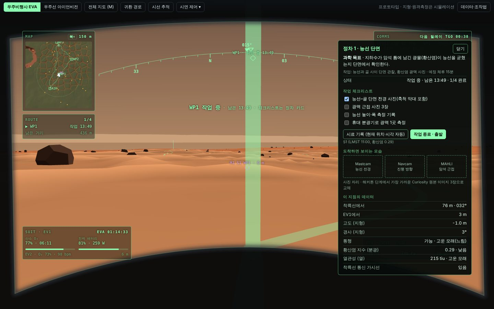
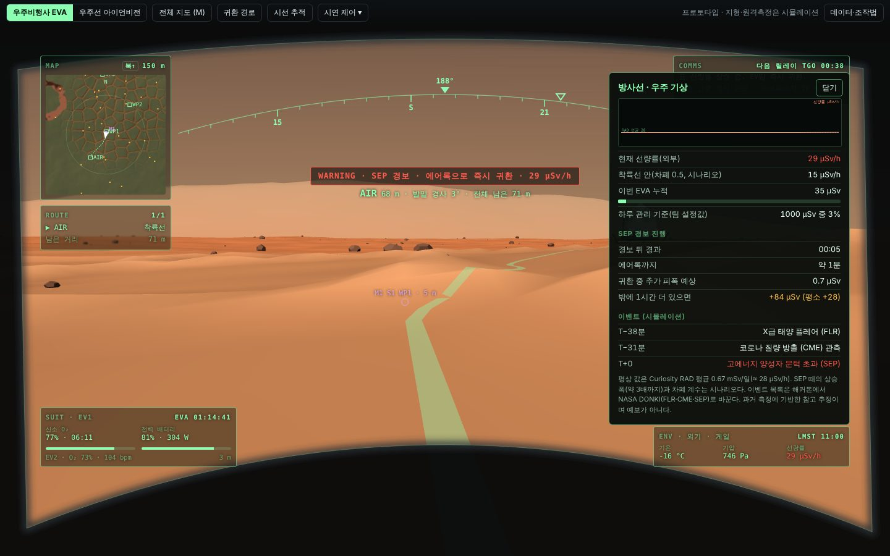
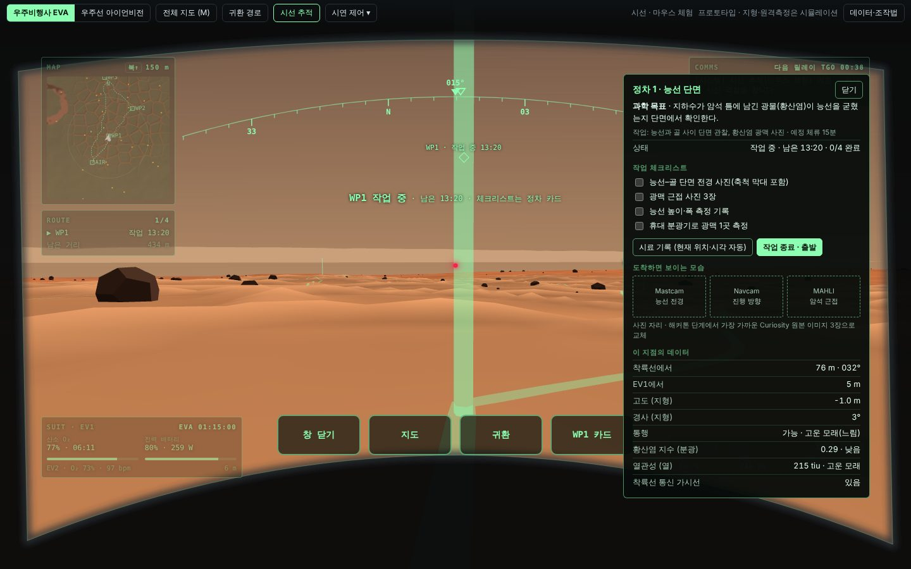

# Martian Map · Marswalk HUD

NASA Space Apps Challenge 2026 「Interplanetary Survival Guide: Martian Map」 참가 프로젝트 (경희대학교, 5인 팀).

화성 게일 크레이터(Mount Sharp 박스워크 지대)에서 우주비행사가 **어디로 걸어가 무엇을 조사할지** 계획하고, 그 계획을 **헬멧 HUD**와 **착륙선 아이언비전 화면**으로 보여주는 웹 앱이다. 지금 단계는 NASA 챌린지 데이터가 공개되기 전의 **UI/UX 프로토타입 + 개발 계획서**다.

> 지형·바위·원격측정·기상 값과 지도 레이어(광물·열관성·통신 가시선)는 브라우저에서 만든 시뮬레이션이다. 대기 성분(Curiosity SAM)처럼 근거가 있는 값은 화면 안 `데이터·조작법`과 계획서에 출처를 적었다.


## 바로 실행

설치가 필요 없다. `prototype/marswalk-hud.html`을 Chrome에서 열면 된다(인터넷 연결 필요: three.js, 글꼴, 시선 추적 모델을 CDN에서 받는다).

```bash
# 또는 로컬 서버로
cd prototype && python -m http.server 8000
# → http://localhost:8000/marswalk-hud.html
```

## 화면 구성

| 모드 | 내용 |
|---|---|
| 우주비행사 EVA | 헬멧 바이저 HUD. 기본은 **간결 HUD**: 패널마다 핵심 한 줄(O₂ 남은 시간, 다음 목적지, 기온·기압·선량률)만 보이고, 마우스를 올리거나 바라보거나 제목을 누르면 펼쳐진다. 왼쪽 위 미니맵(북쪽 위 / 진행 방향 위)·경로, 왼쪽 아래 **SUIT**, 오른쪽 위 통신, 오른쪽 아래 **ENV 외기**, 위쪽 방위 테이프, 경고는 시선 가까이 |
| 우주선 아이언비전 · 접근 비행 | 화성으로 다가가는 캡슐에서 선체를 투시해 화성과 착륙 목표를 본다. 진입까지 남은 시간, 순항 단 분리(E−10분), EDL 단계 |
| 우주선 아이언비전 · 착륙 후 | 착륙선은 고정. 시점만 360° 돌려 EV 대원·정차 지점·위험 지형을 추적 |

| 접근 비행 | 착륙 후 |
|---|---|
|  |  |

## 주요 기능

- **데이터 레이어** (`M` 지도): 음영 기복 위에 경사·고도(지형), 황산염 지수(분광), 열관성(열), 통신 가시선 중 하나를 투명도 조절해 겹친다. **조회** 도구로 아무 지점이나 누르면 모든 레이어 값이 한 창에 나오고 거기서 경유지·마커·이동을 바로 지정한다.
- **안전 경로**: 5 m 격자 A* 탐색. 경사가 클수록, 고운 모래(열관성 낮음)일수록 비용 증가. 25° 이상·큰 바위 셀은 제외. 길이 없는 경유지는 **도달 불가**로 빨갛게 표시하고 전송을 막는다.
- **탐사 계획과 소모품 예산**: 끌어서 이동·휠 확대, 경유지별 체류 시간, 고도 단면. 보행+체류 시간으로 귀환 시 O₂·배터리·일몰 여유를 계산하고, 예비(O₂ 15%·배터리 10%·일몰 30분 전)를 지키려면 돌아서야 하는 **회귀 한계 지점**을 경로 위에 표시한다. 마커 4종(과학 관심·시료·위험·메모)은 지도·미니맵·3D에 모두 표시.
- **과학 작업 흐름**: 정차 지점에 도착하면 보행이 멈추고 정차 카드(과학 목표·체크리스트·체류 타이머·현장 사진 자리·지점 데이터)가 열린다. 시료 기록은 위치·현지 시각·광물 지수가 자동으로 붙어 마커로 남는다. 에어록에 도착하면 EVA 종료.
- **상세 창**: 패널 항목, 3D 표지, 경고 배너, 미니맵을 누르면 해당 상세 창이 뜬다(구간 단면·건너뛰기, SUIT 추세·귀환 시 예측, 하루 기온 곡선, 방사선·우주 기상, 경고 원인·절차·확인, 릴레이 일정, 대원 원격측정, EDL 단계). `Esc`로 닫는다.
- **EV2**: 독립된 위치·산소·심박을 가진 동료. 25 m 넘게 떨어지면 이격 경고.
- **통신 두절 시 자율 귀환** (`통신 두절 시험`): 관성 항법 + 브레드크럼, 지형 대조·태양 나침반·착륙선 비컨으로 오차 보정. 귀환 화살표, 위치 오차 원, 산소 기준 출발 마감, 90초 무응답 시 왔던 길 역추적.
- **시선 추적** (`시선 추적`): 노트북 카메라 + WebGazer.js. 보정은 13점 클릭 → 고개 돌리기 → 5점 검증 순서이고, 검증에서 잰 오차(px)로 시선 버튼 크기와 응시 시간을 정한다. 화면 아래 큰 **시선 버튼**(지도·귀환·정차 카드·경고 확인)과 3D 표지를 약 1초 바라보면 눌리고, 귀환·경로 전송은 ‘실행’을 한 번 더 바라봐야 한다. 얼굴을 놓치거나 화면 밖을 보면 응시가 초기화된다. One Euro 필터, 응시 성공 시 오프셋 자동 보정, 추적 품질 표시. 카메라가 없으면 마우스 체험 모드.
- **우주 기상**: SEP 경보 시험 → 선량률 상승(시나리오 약 3배), 즉시 귀환 경로, 귀환 중 예상 피폭. 경보를 끄면 중단했던 계획을 복원.
- **시연 제어**: 자동 보행, 시간 배속(×1/×8/×30), SEP·통신 두절 시험, 간결 HUD, 현지 시각 슬라이더(조명·일몰 여유·태양 나침반에 반영)는 상단 `시연 제어 ▾`에 모았다.

| 지도 계획 (광물 레이어·고도 단면) | 지점 조회 (통신 가시선 레이어) |
|---|---|
|  |  |

| 정차 카드 | SEP 경보·방사선 |
|---|---|
|  |  |

| 통신 두절 | 시선 버튼 |
|---|---|
|  |  |

## 조작

| 키 | 동작 |
|---|---|
| 드래그 | 둘러보기 |
| `W A S D` / 방향키 | 걷기(자동 보행 해제) |
| `M` | 지도 (끌어서 이동, 휠 확대) |
| `Esc` | 맨 위 창 닫기 |
| 패널·표지·경고 클릭 | 상세 창 |
| `H` | 귀환 경로 (통신 두절 중에는 왔던 길 역추적) |
| `Tab` | EVA ↔ 아이언비전 (지도·창이 닫혀 있을 때) |
| `C` | 시선 추적 중 고개 정면 다시 맞추기 |

## 폴더

```
prototype/marswalk-hud.html   단일 파일 프로토타입 (three.js r128)
docs/development-plan.md      개발 계획서 (데이터 계층·분석 엔진·HUD 설계·일정·역할·리스크)
docs/screenshots/             README 이미지
```

## 알려진 한계

- 화면은 노트북(가로 1024px 이상) 기준이다. 휴대폰 세로 화면에서는 패널이 겹친다.
- 카메라 시선 추적은 실제 카메라가 있는 Chrome에서만 확인할 수 있다. 자동 점검은 마우스 체험 모드로만 했다.
- 정차 카드의 현장 사진, 지도 레이어 값, 우주 기상 이벤트는 자리만 있거나 시뮬레이션이다.

## 다음 단계 (해커톤 11/14–15)

계획서 12장 체크리스트 참고. 요약하면 챌린지 데이터가 공개되는 대로 어댑터를 붙여 시뮬레이션 지형을 HiRISE DTM·CRISM 광물·THEMIS 열관성·REMS 기상 실측으로 교체하고, 경로·마커를 백엔드(`POST /plan`, `POST /markers`)에 저장해 EV 화면과 기지 화면이 공유하게 한다.

## 라이선스 메모

- 시선 추적에 쓰는 [WebGazer.js](https://webgazer.cs.brown.edu/)는 **GPL-3.0**이다. 저장소에 포함하지 않고 실행 시 CDN에서 불러온다. 다른 라이선스로 배포하려면 계획서 6.6의 대안(MediaPipe Face Landmarker, Apache-2.0)을 검토한다.
- three.js는 MIT.
- 이 저장소 자체의 라이선스는 팀에서 정한다.
